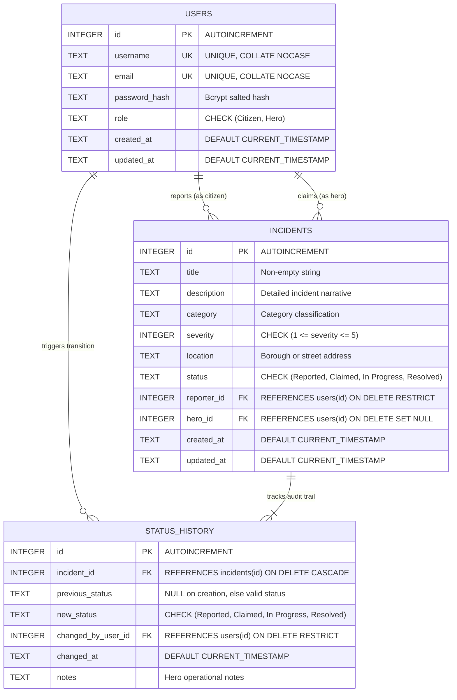
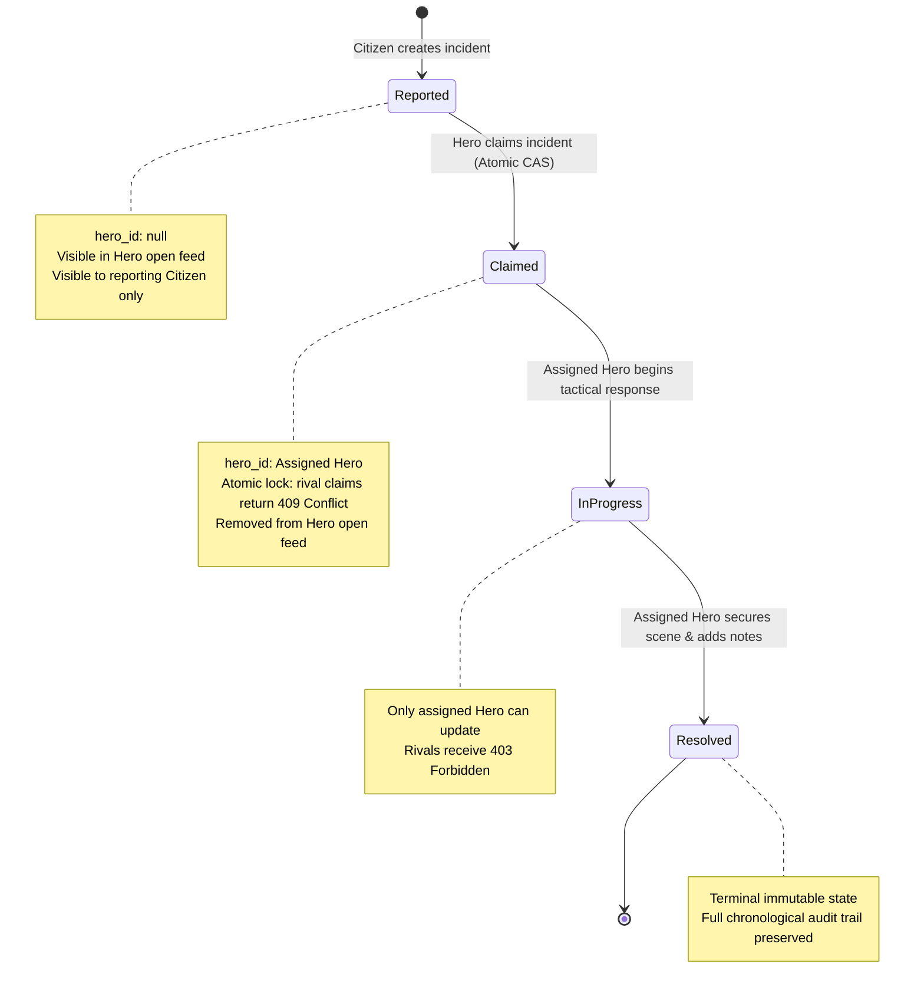

# 🕷️ Spider-Sense NYC Emergency Network

[](https://nodejs.org/)
[](https://expressjs.com/)
[](https://www.mongodb.com/)
[-success?logo=github-actions&logoColor=white)](#automated-testing--verification)
[](LICENSE)

A mission-critical emergency response platform and backend service for New York City's superhero alert network. The Spider-Sense network empowers citizens across all five boroughs to report crimes and hazards in real time, while authenticated heroes discover, claim, and resolve incidents with guaranteed concurrency protection and an append-only audit trail.

---

## 🌟 Key Features

- **Dual Web Portals**:
  - 🏙️ **Citizen Reporting Portal (`/`)**: Real-time emergency filing with category categorization, threat severity level (1 to 5), geolocation, and isolated personal report tracking.
  - 🦸 **Hero Command Room (`/admin`)**: Real-time citywide emergency feed, one-click mission claim, multi-stage lifecycle progression, and chronological audit trail viewer.
  - 🔑 **Multi-Factor Authentication Portals (`/login`, `/register`)**:
    - Sign in via salted password OR instantaneous 6-digit email OTP.
    - Automatic hero email detection with direct routing to `/admin`.
    - Sign-up email verification step with password confirmation.
    - Long-lived 7-day JWT persistent sessions.
- **Strict Role-Based Access Control (RBAC)**: Backend-enforced role segregation guaranteeing Citizens cannot access administrative endpoints or claim incidents, and Heroes cannot report civilian complaints.
- **Atomic Concurrency (CAS)**: Lock-free atomic Compare-And-Swap updates guarantee that when multiple heroes attempt to claim the same emergency simultaneously, exactly one hero succeeds and contenders receive `409 Conflict`.
- **Dual-Engine Persistence**:
  - **Production/Dev**: MongoDB Atlas via Mongoose with connection pooling and resilient automatic reconnect.
  - **Testing**: Built-in zero-dependency native SQLite (`node:sqlite`) with strict relational constraints and foreign keys.
- **Multi-Channel Email Delivery**: Automated verification OTPs powered by Resend API with automatic failover to Gmail SMTP.

---

## 🧭 Live Web Portals

When the server is running on `http://localhost:3000`:

| Portal | URL | Description | Target Role |
| :--- | :--- | :--- | :--- |
| **Citizen Portal** | `http://localhost:3000/` | Report emergencies & track personal reports | `Citizen` |
| **Hero Command Room** | `http://localhost:3000/admin` | Live open mission feed, claim & resolve operations | `Hero` |
| **Sign In** | `http://localhost:3000/login` | Sign in with Password or Email OTP | All |
| **Sign Up** | `http://localhost:3000/register` | Register new account with OTP email verification | All |
| **Health Check** | `http://localhost:3000/health` | Service uptime and status probe | Public |

---

## 📐 Architecture & Entity-Relationship (ER) Model

### Relational Database Schema (SQLite)



### Document Model (MongoDB Atlas)

- **`users` Collection**:
  - `_id`: ObjectId
  - `username`: String (Unique, index)
  - `email`: String (Unique, lowercase, index)
  - `password`: String (Bcrypt salted hash)
  - `role`: `'Citizen'` | `'Hero'`
  - `isVerified`: Boolean (Email verification flag)
  - `createdAt`, `updatedAt`: Timestamps
- **`incidents` Collection**:
  - `_id`: ObjectId
  - `title`, `description`, `category`, `location`: String
  - `severity`: Number (1 to 5)
  - `status`: `'Reported'` | `'Claimed'` | `'In Progress'` | `'Resolved'`
  - `reporter`: ObjectId (ref: `User`)
  - `hero`: ObjectId (ref: `User`, nullable until claimed)
  - `statusHistory`: Array of `{ previous_status, new_status, changed_by, changed_at, notes }`
- **`otps` Collection**:
  - `email`: String (lowercase)
  - `otpHash`: String (HMAC SHA-256)
  - `purpose`: `'signup'` | `'login'`
  - `expiresAt`: Date (TTL index: 10 minutes)
- **`sessions` Collection**:
  - `userId`: ObjectId
  - `token`: String (JWT)
  - `userAgent`, `ipAddress`: String
  - `expiresAt`: Date (7-day lifecycle)

---

## 🔄 Incident Lifecycle & State Machine

Every emergency report follows a strict, non-reversible state machine:



### State Transition Validation Rules:
1. **`Reported ➔ Claimed`**: Any verified Hero can claim an open report. Concurrency collisions are rejected with `409 Conflict`.
2. **`Claimed ➔ In Progress`**: Only the specifically assigned Hero can advance the mission status.
3. **`In Progress ➔ Resolved`**: Only the assigned Hero can conclude the mission, appending operational logs.
4. **Invalid Jumps**: Skipping states (e.g. `Reported ➔ Resolved`), backward transitions (e.g. `In Progress ➔ Reported`), or modifying a resolved incident return `400 Bad Request`.

---

## 🛡️ Role-Based Access Control (RBAC) Matrix

| Endpoint | Method | Citizen | Hero | Unauthenticated |
| :--- | :--- | :---: | :---: | :---: |
| `/api/auth/register` | `POST` | Allowed | Allowed | Allowed |
| `/api/auth/login` | `POST` | Allowed | Allowed | Allowed |
| `/api/auth/check-email` | `POST` | Allowed | Allowed | Allowed |
| `/api/auth/send-otp` | `POST` | Allowed | Allowed | Allowed |
| `/api/auth/verify-otp` | `POST` | Allowed | Allowed | Allowed |
| `/api/auth/me` | `GET` | Own profile | Own profile | 401 Unauthorized |
| `/api/incidents` | `POST` | Allowed (Severity 1-5) | 403 Forbidden | 401 Unauthorized |
| `/api/incidents` | `GET` | Own reports only | Open (`Reported`) feed | 401 Unauthorized |
| `/api/incidents/:id` | `GET` | Own report only | Any incident | 401 Unauthorized |
| `/api/incidents/:id/claim` | `POST` | 403 Forbidden | Allowed (Open only) | 401 Unauthorized |
| `/api/incidents/:id/status` | `PATCH` | 403 Forbidden | Assigned hero only | 401 Unauthorized |
| `/api/incidents/:id/history` | `GET` | Own report only | Any incident | 401 Unauthorized |

---

## 📡 REST API Reference

All protected endpoints require the Bearer token header:
```http
Authorization: Bearer <jwt_token>
```

### 1. Authentication & OTP

#### Check Email Existence & Role
```http
POST /api/auth/check-email
Content-Type: application/json

{ "email": "peter@dailybugle.nyc" }
```
**Response (200 OK):**
```json
{
  "exists": true,
  "role": "Citizen",
  "isHero": false
}
```

#### Dispatch Email OTP
```http
POST /api/auth/send-otp
Content-Type: application/json

{
  "email": "peter@dailybugle.nyc",
  "purpose": "login"
}
```
**Response (200 OK):**
```json
{
  "success": true,
  "message": "Verification OTP sent successfully"
}
```

#### Sign In with Password or OTP
```http
POST /api/auth/login
Content-Type: application/json

{
  "email": "peter@dailybugle.nyc",
  "password": "SuperSecretPassword123!"
}
```
*Or with OTP:*
```http
POST /api/auth/login
Content-Type: application/json

{
  "email": "peter@dailybugle.nyc",
  "otp": "492810"
}
```
**Response (200 OK):**
```json
{
  "message": "Login successful",
  "user": {
    "id": "672251a...",
    "email": "peter@dailybugle.nyc",
    "role": "Citizen"
  },
  "token": "eyJhbGciOiJIUzI1NiIsInR5cCI6IkpXVCJ9..."
}
```

---

### 2. Incident Management

#### Create Incident Report (Citizens Only)
```http
POST /api/incidents
Authorization: Bearer <citizen_token>
Content-Type: application/json

{
  "title": "Armed Robbery at Midtown Bank",
  "description": "Masked syndicate drilling vault with shock tech",
  "category": "Robbery",
  "severity": 5,
  "location": "5th Ave & 42nd St, Manhattan"
}
```
**Response (201 Created):**
```json
{
  "id": "672252b...",
  "title": "Armed Robbery at Midtown Bank",
  "description": "Masked syndicate drilling vault with shock tech",
  "category": "Robbery",
  "severity": 5,
  "location": "5th Ave & 42nd St, Manhattan",
  "status": "Reported",
  "reporter": "672251a...",
  "hero": null,
  "createdAt": "2026-10-30T15:30:00.000Z"
}
```

#### List Incidents (Filtering & Pagination)
```http
GET /api/incidents?status=Reported&category=Robbery&severity=5&page=1&limit=10
Authorization: Bearer <hero_token>
```
**Response (200 OK):**
```json
{
  "items": [
    {
      "id": "672252b...",
      "title": "Armed Robbery at Midtown Bank",
      "category": "Robbery",
      "severity": 5,
      "location": "5th Ave & 42nd St, Manhattan",
      "status": "Reported",
      "createdAt": "2026-10-30T15:30:00.000Z"
    }
  ],
  "total": 1,
  "page": 1,
  "pageSize": 10,
  "totalPages": 1
}
```

#### Claim an Incident (Heroes Only)
```http
POST /api/incidents/672252b.../claim
Authorization: Bearer <hero_token>
```
**Response (200 OK):**
```json
{
  "id": "672252b...",
  "status": "Claimed",
  "hero": "672250f...",
  "updatedAt": "2026-10-30T15:32:00.000Z"
}
```
*(If already claimed by another hero, returns HTTP `409 Conflict`)*

#### Update Incident Status (Assigned Hero Only)
```http
PATCH /api/incidents/672252b.../status
Authorization: Bearer <hero_token>
Content-Type: application/json

{
  "status": "In Progress",
  "notes": "Arrived on scene, securing the lobby perimeter."
}
```
**Response (200 OK):**
```json
{
  "id": "672252b...",
  "status": "In Progress",
  "hero": "672250f...",
  "updatedAt": "2026-10-30T15:35:00.000Z"
}
```

#### Get Incident Audit History
```http
GET /api/incidents/672252b.../history
Authorization: Bearer <token>
```
**Response (200 OK):**
```json
[
  {
    "previous_status": null,
    "new_status": "Reported",
    "changed_by": "672251a...",
    "changed_at": "2026-10-30T15:30:00.000Z",
    "notes": null
  },
  {
    "previous_status": "Reported",
    "new_status": "Claimed",
    "changed_by": "672250f...",
    "changed_at": "2026-10-30T15:32:00.000Z",
    "notes": null
  },
  {
    "previous_status": "Claimed",
    "new_status": "In Progress",
    "changed_by": "672250f...",
    "changed_at": "2026-10-30T15:35:00.000Z",
    "notes": "Arrived on scene, securing the lobby perimeter."
  }
]
```

---

## 🚀 Quick Start Guide

### 1. Prerequisites
- **Node.js**: Version `>= 22.0.0`
- **npm**: Version `>= 10.0.0`
- **MongoDB**: MongoDB Atlas Cluster connection URI (or local MongoDB daemon)

### 2. Installation
```bash
git clone https://github.com/selotechaitanya-svg/tcb_back.git
cd tcb_back
npm install
```

### 3. Environment Configuration
Copy the provided `.env.example` file to `.env`:
```bash
cp .env.example .env
```
Update with your configuration:
```env
PORT=3000
NODE_ENV=development
MONGODB_URI=mongodb+srv://<user>:<password>@cluster.mongodb.net/spider-sense?retryWrites=true&w=majority
JWT_SECRET=your-secure-jwt-secret-here
JWT_ACCESS_EXPIRE=7d
OTP_HASH_SECRET=your-otp-hmac-secret-here
HERO_EMAILS=selotechaitanya09@gmail.com,spiderman@nyc.gov

# Email Delivery (Resend API)
RESEND_API_KEY=re_your_api_key_here
EMAIL_FROM=Spider-Sense Dispatch <onboarding@resend.dev>

# Email Delivery Fallback (Gmail SMTP)
EMAIL_SERVICE=gmail
EMAIL_USER=your_email@gmail.com
EMAIL_PASS=your_gmail_app_password
```

### 4. Start the Application
```bash
# Start in production mode
npm start

# Start in development mode with auto-reload
npm run dev
```

Open your browser at `http://localhost:3000` to access the Citizen Portal or `http://localhost:3000/login` to sign in.

---

## 🧪 Automated Testing & Verification

The Spider-Sense test harness is built with Node.js's native test runner (`node:test`) and supertest, providing **100% pass coverage across 263 tests and 62 suites** with zero external database dependencies:

```bash
npm test
```

### Test Suite Architecture:
- **`tests/auth.test.js`**: Registration, salted hashing, JWT verification, role assignment, case collisions.
- **`tests/adversarial_m1.test.js`**: JWT signature tampering, expired token rejection, prototype pollution defenses, SQL injection immunity.
- **`tests/adversarial_m2_concurrency.test.js`**: High-concurrency simultaneous hero claims and atomic CAS enforcement.
- **`tests/adversarial_m2_lifecycle.test.js`**: Strict status machine jump invalidation and audit trail preservation.
- **`tests/e2e/tier1_feature_coverage.test.js`**: End-to-end user journeys for both Citizen and Hero personas.
- **`tests/e2e/tier2_boundary_corner.test.js`**: Pagination bounds, invalid severities, and payload edge cases.
- **`tests/e2e/tier3_cross_feature.test.js`**: Inter-feature workflows (Filter + Paginate + State Transition).
- **`tests/e2e/tier4_real_world.test.js`**: Multi-borough neighborhood simulations and concurrent hero shifts.

```bash
# Run unit & adversarial tests only
npm run test:unit

# Run end-to-end suites only
npm run test:e2e
```

---

## 📂 Project Structure

```
tcb_back/
├── public/                       # Frontend Web Portals
│   ├── index.html                # Citizen Incident Reporting Portal
│   ├── admin.html                # Hero Command Room
│   ├── login.html                # Authentication (Password & Email OTP)
│   └── register.html             # Account Sign-Up with Verification
├── src/
│   ├── config/
│   │   └── config.js             # Environment & service configurations
│   ├── controllers/
│   │   ├── authController.js     # Auth, session, & OTP handlers
│   │   └── incidentController.js # Incident CRUD & lifecycle handlers
│   ├── db/
│   │   ├── database.js           # SQLite engine & atomic transaction wrapper
│   │   ├── mongodb.js            # MongoDB Atlas connection manager & retry
│   │   └── schema.sql            # Relational DDL with CHECK constraints
│   ├── middleware/
│   │   ├── auth.js               # JWT verification & token validation
│   │   ├── errorHandler.js       # Centralized error mapping & HTTP response
│   │   └── rbac.js               # Strict Citizen & Hero role guards
│   ├── models/
│   │   ├── Incident.js           # Mongoose Incident model
│   │   ├── Otp.js                # Mongoose OTP model with TTL
│   │   ├── Session.js            # Mongoose Session model
│   │   └── User.js               # Mongoose User model
│   ├── routes/
│   │   ├── authRoutes.js         # Authentication route declarations
│   │   └── incidentRoutes.js     # Incident route declarations
│   ├── services/
│   │   ├── authService.js        # Auth logic, JWT issuance, password verification
│   │   ├── emailService.js       # Resend & Nodemailer dual dispatch
│   │   └── incidentService.js    # Concurrency-safe incident operations
│   ├── utils/
│   │   ├── errors.js             # Custom AppError classes
│   │   ├── security.js           # Cryptographic token & hash helpers
│   │   └── validator.js          # Input validation schemas
│   ├── app.js                    # Express app configuration & static routes
│   └── server.js                 # HTTP server listener & graceful shutdown
├── tests/                        # Automated Test Suites (263 tests)
│   ├── adversarial_m1.test.js
│   ├── adversarial_m2_concurrency.test.js
│   ├── adversarial_m2_lifecycle.test.js
│   ├── e2e/
│   │   ├── tier1_feature_coverage.test.js
│   │   ├── tier2_boundary_corner.test.js
│   │   ├── tier3_cross_feature.test.js
│   │   └── tier4_real_world.test.js
│   └── ...
├── .env.example                  # Environment configuration template
├── .gitignore                    # Git ignore definitions
├── package.json                  # Dependencies & scripts
└── README.md                     # Documentation
```

---

## 📄 License

This project is licensed under the MIT License — see the [LICENSE](LICENSE) file for details.
