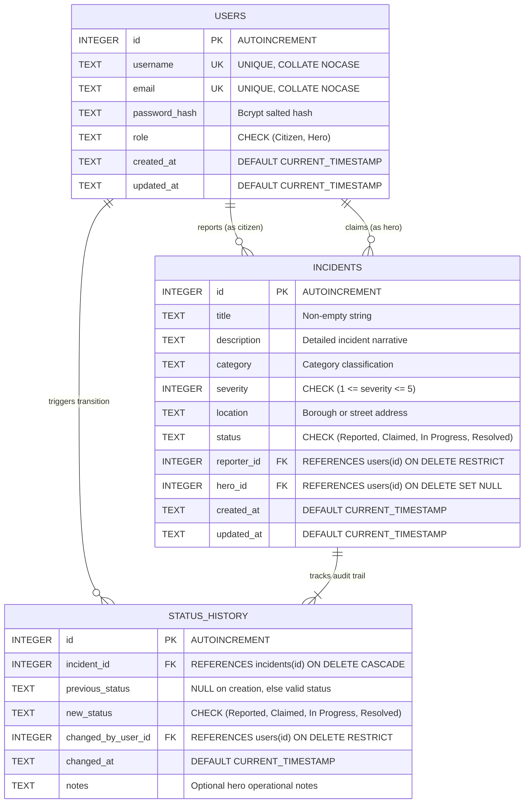
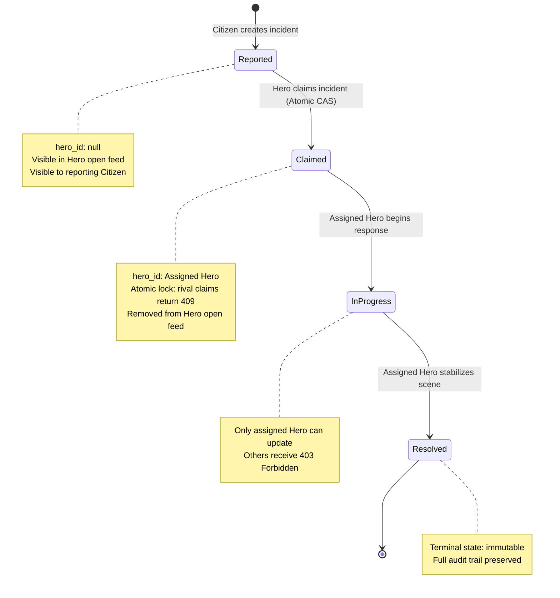

# Spider-Sense Alert System — Backend Service

A high-reliability, mission-critical backend service for New York City's superhero alert network. The Spider-Sense Alert System allows citizens across the five boroughs to report emergencies and heroes to discover, claim, and resolve them with guaranteed concurrency safety and a tamper-evident audit trail.

---

## Architecture Overview

- **Runtime & Framework**: Node.js (>= 22.0.0) with Express.js.
- **Relational Database Engine**: Native `node:sqlite` (`DatabaseSync`), featuring immediate transactions, foreign-key cascade & restrict rules, CHECK constraints, and WAL (Write-Ahead Logging) mode. Runs in-memory (`:memory:`) during automated tests for zero-daemon operation and immunity to filesystem locks, and persists to disk (`data/spidersense.db`) in development/production.
- **Authentication & RBAC**: Stateless Bearer JWT tokens signed via `jsonwebtoken` with salted password hashing powered by `bcryptjs`. Strict server-side route guards enforce `Citizen` and `Hero` roles.
- **Atomic Concurrency & State Machine**: Compare-and-Swap (CAS) atomic updates (`UPDATE incidents SET status = 'Claimed', hero_id = :heroId WHERE id = :id AND status = 'Reported'`) ensure that concurrent claim attempts by rival heroes result in exactly one successful claim and HTTP 409 Conflict for contenders.
- **Audit Logging**: Append-only chronological tracking in `status_history` capturing every status transition, the acting user, timestamp, and optional incident notes.

---

## Entity-Relationship (ER) Diagram

The system models relationships between users, incident reports, and the append-only status transition history:



### Relational Schema Rules
1. **`users` Table**:
   - `role` must be either `'Citizen'` or `'Hero'`.
   - `username` and `email` are unique with case-insensitive collision prevention (`COLLATE NOCASE`).
2. **`incidents` Table**:
   - `severity` is restricted to integers from `1` (minor) to `5` (catastrophic).
   - `status` strictly tracks the state machine (`Reported`, `Claimed`, `In Progress`, `Resolved`).
   - `reporter_id` references `users(id)` with `ON DELETE RESTRICT` (reporters cannot be deleted while their incident records exist).
   - `hero_id` references `users(id)` with `ON DELETE SET NULL` (nullable until claimed).
3. **`status_history` Table**:
   - `incident_id` references `incidents(id)` with `ON DELETE CASCADE` (deleting an incident purges its audit records).
   - `changed_by_user_id` references `users(id)` with `ON DELETE RESTRICT`.

---

## Incident State Machine



- **Reported → Claimed**: Only an authenticated user with role `Hero` can claim. Race conditions are handled atomically via SQL CAS.
- **Claimed → In Progress**: Only the assigned `hero_id` can advance the state.
- **In Progress → Resolved**: Only the assigned `hero_id` can mark the incident as resolved.
- **Illegal Transitions**: Direct jumps (e.g., `Reported → In Progress`, `Reported → Resolved`, `Claimed → Resolved`), backward regressions (`In Progress → Reported`), or mutations on `Resolved` return HTTP `400 Bad Request`.

---

## Role-Based Access Control (RBAC) Matrix

| Endpoint | Method | Citizen | Hero | Unauthenticated |
| :--- | :--- | :---: | :---: | :---: |
| `/api/auth/register` | `POST` | Allowed | Allowed | Allowed |
| `/api/auth/login` | `POST` | Allowed | Allowed | Allowed |
| `/api/auth/me` | `GET` | Allowed | Allowed | 401 Unauthorized |
| `/api/incidents` | `POST` | Allowed | 403 Forbidden | 401 Unauthorized |
| `/api/incidents` | `GET` | Own reports only | Open (`Reported`) by default | 401 Unauthorized |
| `/api/incidents/:id` | `GET` | Own reports only | Any incident | 401 Unauthorized |
| `/api/incidents/:id/claim` | `POST` | 403 Forbidden | Allowed (Open only) | 401 Unauthorized |
| `/api/incidents/:id/status` | `PATCH` | 403 Forbidden | Assigned hero only | 401 Unauthorized |
| `/api/incidents/:id/history` | `GET` | Own reports only | Any incident | 401 Unauthorized |

---

## API Specification

All protected endpoints require the HTTP header:
```http
Authorization: Bearer <jwt_token>
```

### 1. Authentication

#### Register a New User
```http
POST /api/auth/register
Content-Type: application/json

{
  "username": "peter_parker",
  "email": "peter@dailybugle.nyc",
  "password": "SecretPassword123!",
  "role": "Citizen"
}
```
**Response (201 Created):**
```json
{
  "message": "User registered successfully",
  "user": {
    "id": 1,
    "username": "peter_parker",
    "email": "peter@dailybugle.nyc",
    "role": "Citizen",
    "created_at": "2026-10-30T00:00:00.000Z",
    "updated_at": "2026-10-30T00:00:00.000Z"
  },
  "token": "eyJhbGciOiJIUzI1NiIsInR5cCI6IkpXVCJ9..."
}
```

#### User Login
```http
POST /api/auth/login
Content-Type: application/json

{
  "username": "peter_parker",
  "password": "SecretPassword123!"
}
```
**Response (200 OK):**
```json
{
  "message": "Login successful",
  "user": {
    "id": 1,
    "username": "peter_parker",
    "email": "peter@dailybugle.nyc",
    "role": "Citizen"
  },
  "token": "eyJhbGciOiJIUzI1NiIsInR5cCI6IkpXVCJ9..."
}
```

---

### 2. Incident Management

#### Report an Incident
*Available to `Citizen` role only.*
```http
POST /api/incidents
Authorization: Bearer <token>
Content-Type: application/json

{
  "title": "Bank Robbery Midtown",
  "description": "Armed crew with shock blasters breaching vault",
  "category": "Robbery",
  "severity": 5,
  "location": "5th Ave & 42nd St, Manhattan"
}
```
**Response (201 Created):**
```json
{
  "id": 42,
  "title": "Bank Robbery Midtown",
  "description": "Armed crew with shock blasters breaching vault",
  "category": "Robbery",
  "severity": 5,
  "location": "5th Ave & 42nd St, Manhattan",
  "status": "Reported",
  "reporter_id": 1,
  "hero_id": null,
  "created_at": "2026-10-30T00:00:00.000Z",
  "updated_at": "2026-10-30T00:00:00.000Z"
}
```

#### List Incidents (with Filtering & Pagination)
*Citizens see only their own reports. Heroes see all open `Reported` incidents by default, or filtered results.*
```http
GET /api/incidents?category=Fire&severity=5&page=1&limit=10
Authorization: Bearer <token>
```
**Query Parameters:**
- `status`: Filter by status (`Reported`, `Claimed`, `In Progress`, `Resolved`).
- `category`: Filter by incident category (e.g. `Robbery`, `Fire`, `Hazard`, `Rescue`).
- `severity`: Filter by severity integer (`1` to `5`).
- `page`: Page number (default: `1`).
- `limit`: Page size limit (default: `20`, max: `100`).

**Response (200 OK):**
```json
{
  "items": [
    {
      "id": 42,
      "title": "Bank Robbery Midtown",
      "category": "Robbery",
      "severity": 5,
      "location": "5th Ave & 42nd St, Manhattan",
      "status": "Reported",
      "reporter_id": 1,
      "hero_id": null,
      "created_at": "2026-10-30T00:00:00.000Z",
      "updated_at": "2026-10-30T00:00:00.000Z"
    }
  ],
  "total": 1,
  "page": 1,
  "pageSize": 10,
  "totalPages": 1
}
```

#### Get Incident Details
```http
GET /api/incidents/42
Authorization: Bearer <token>
```
**Response (200 OK):**
```json
{
  "id": 42,
  "title": "Bank Robbery Midtown",
  "description": "Armed crew with shock blasters breaching vault",
  "category": "Robbery",
  "severity": 5,
  "location": "5th Ave & 42nd St, Manhattan",
  "status": "Reported",
  "reporter_id": 1,
  "hero_id": null,
  "created_at": "2026-10-30T00:00:00.000Z",
  "updated_at": "2026-10-30T00:00:00.000Z",
  "history": [
    {
      "id": 101,
      "incident_id": 42,
      "previous_status": null,
      "new_status": "Reported",
      "changed_by_user_id": 1,
      "changed_at": "2026-10-30T00:00:00.000Z",
      "notes": null
    }
  ]
}
```

#### Claim an Incident
*Available to `Hero` role only. Concurrency safe.*
```http
POST /api/incidents/42/claim
Authorization: Bearer <hero_token>
```
**Response (200 OK):**
```json
{
  "id": 42,
  "status": "Claimed",
  "hero_id": 7,
  "updated_at": "2026-10-30T00:05:00.000Z"
}
```
*If another hero already claimed the incident: returns HTTP `409 Conflict`.*

#### Transition Incident Status
*Available to the assigned `Hero` only.*
```http
PATCH /api/incidents/42/status
Authorization: Bearer <hero_token>
Content-Type: application/json

{
  "status": "In Progress",
  "notes": "Engaging perimeters and clearing civilians"
}
```
**Response (200 OK):**
```json
{
  "id": 42,
  "status": "In Progress",
  "hero_id": 7,
  "updated_at": "2026-10-30T00:08:00.000Z"
}
```

#### View Chronological Audit Trail
```http
GET /api/incidents/42/history
Authorization: Bearer <token>
```
**Response (200 OK):**
```json
[
  {
    "id": 101,
    "incident_id": 42,
    "previous_status": null,
    "new_status": "Reported",
    "changed_by_user_id": 1,
    "changed_at": "2026-10-30T00:00:00.000Z",
    "notes": null
  },
  {
    "id": 102,
    "incident_id": 42,
    "previous_status": "Reported",
    "new_status": "Claimed",
    "changed_by_user_id": 7,
    "changed_at": "2026-10-30T00:05:00.000Z",
    "notes": null
  },
  {
    "id": 103,
    "incident_id": 42,
    "previous_status": "Claimed",
    "new_status": "In Progress",
    "changed_by_user_id": 7,
    "changed_at": "2026-10-30T00:08:00.000Z",
    "notes": "Engaging perimeters and clearing civilians"
  },
  {
    "id": 104,
    "incident_id": 42,
    "previous_status": "In Progress",
    "new_status": "Resolved",
    "changed_by_user_id": 7,
    "changed_at": "2026-10-30T00:15:00.000Z",
    "notes": "Suspects webbed and secured, vault locked"
  }
]
```

---

## Getting Started

### Prerequisites
- Node.js >= 22.0.0 (uses native built-in `node:sqlite`)
- npm

### Installation
```bash
npm install
```

### Running the Server
```bash
npm start
```
The server will start listening on port `3000` (or `process.env.PORT`).

---

## Running Automated Verification Tests

The backend includes a comprehensive, multi-tiered automated test suite with **230 passing test cases**:
- **Milestone 1 Unit & Adversarial Tests**: SQL injection, prototype pollution, token bit-flipping, algorithm tampering, case collisions, and transaction rollback atomicity.
- **Milestone 2 & 3 Integration Tests**: Incident CRUD, role authorization, lifecycle state transitions, race-condition claim handling, filtering, and pagination.
- **E2E Tiers 1-4**: Full end-to-end multi-step scenarios, including multi-borough neighborhood watch tenant isolation and simultaneous multi-hero race conditions.

To execute the entire test suite with a single command:
```bash
npm test
```

### Specialized Test Commands
```bash
# Run unit & milestone tests
npm run test:unit

# Run full end-to-end tests (Tiers 1-4)
npm run test:e2e
```
